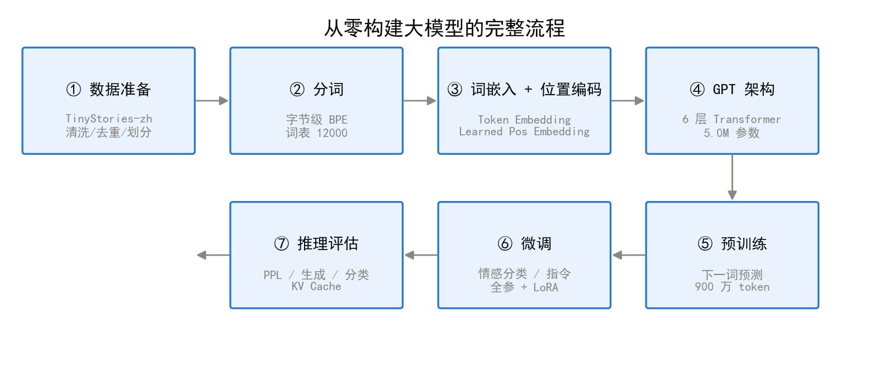
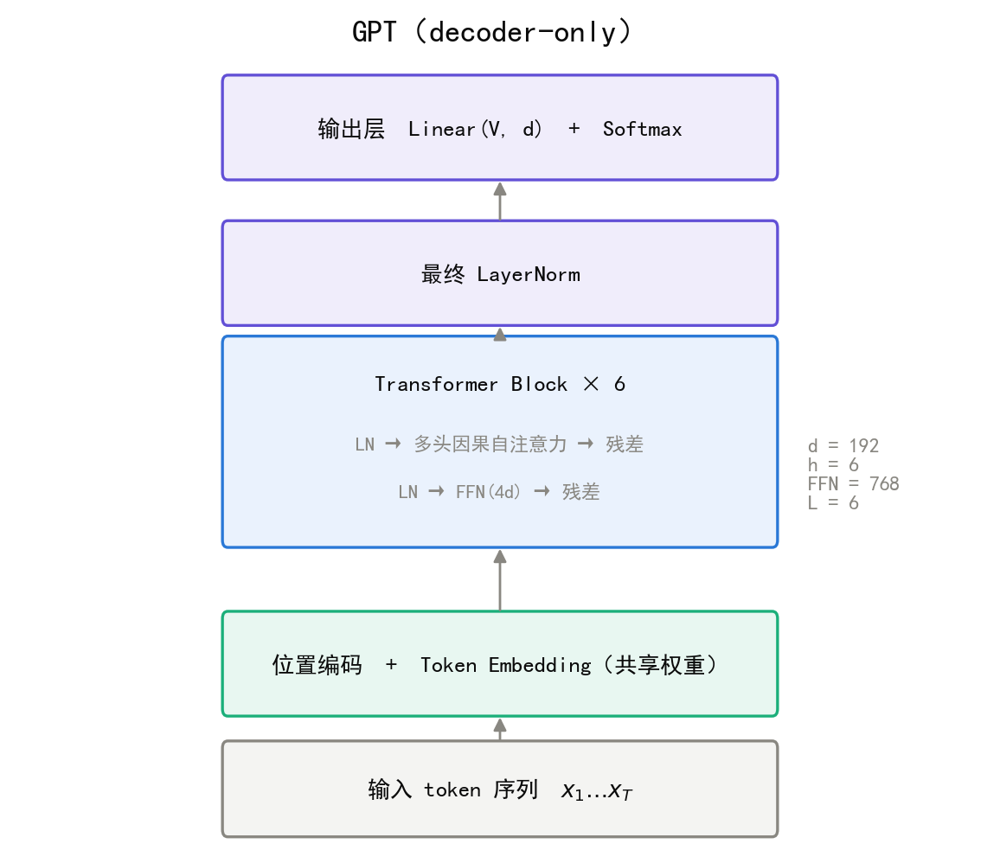
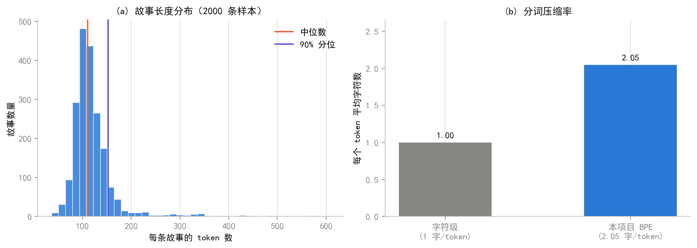
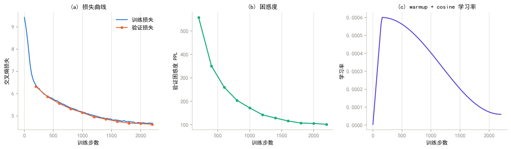
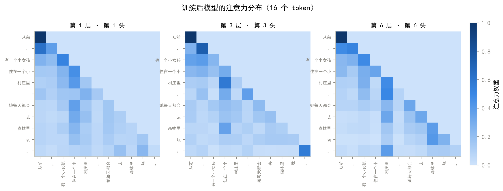
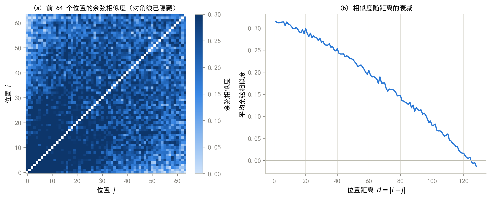
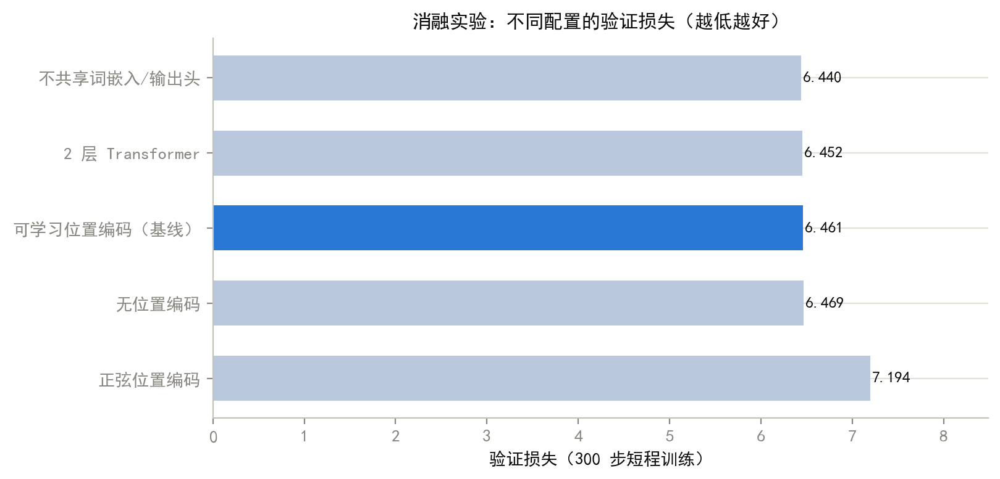
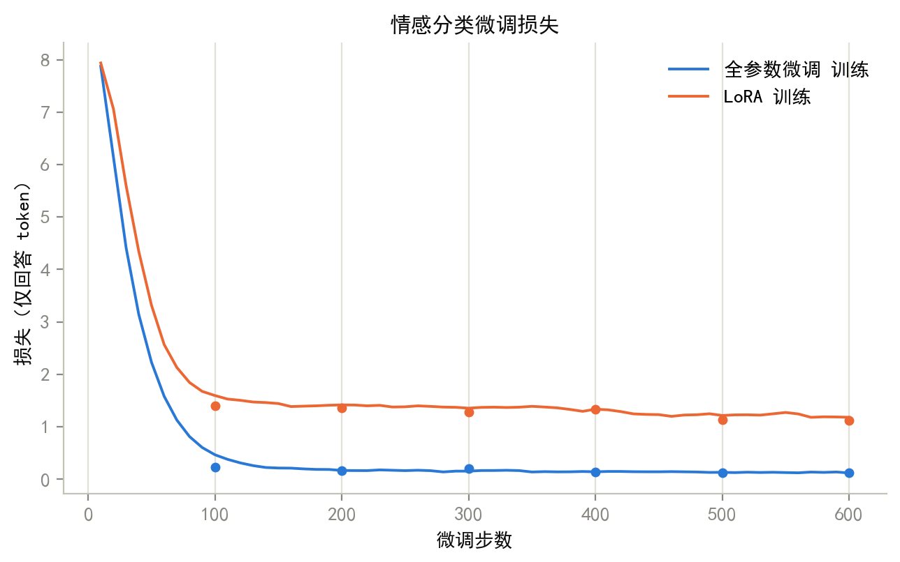
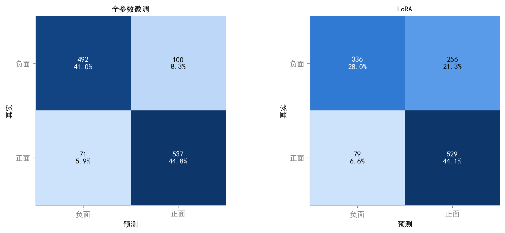
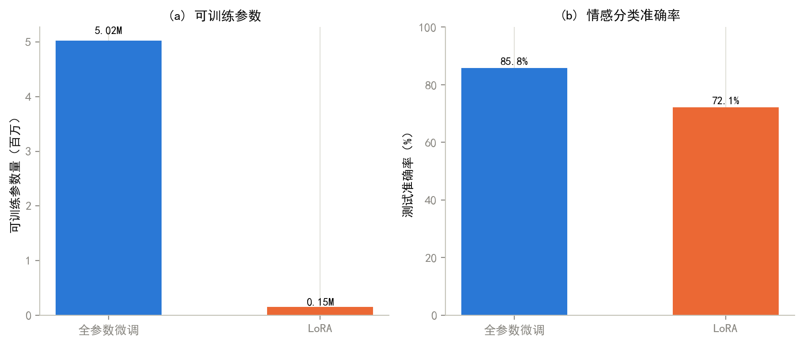

# 一、实验任务

## 1.1 任务要求

作业要求从零构建一个小参数量 GPT 类大语言模型，完整体验“模型搭建—数据准备—预训练—微调—推理”的全过程，具体评分构成如下表。

: 表 1　作业任务与评分构成

| 序号 | 任务内容 | 分值 |
|---|---|---:|
| 1 | 梳理“从零构建大模型”涉及的重要知识点，包括模型架构与配置、训练数据准备、预训练、微调等 | 35% |
| 2 | 搭建小参数量 GPT 架构，支持单机低算力训练与推理，体现大模型核心机制 | 20% |
| 3 | 完成预训练：数据准备、文本分词、词嵌入、位置编码，构建预训练程序并展示效果 | 20% |
| 4 | 完成微调：监督数据构建、微调策略、微调程序，并展示特定任务效果 | 20% |
| 5 | 总结成果与收获，给出项目体会与评价 | 5% |

## 1.2 总体技术路线

整个项目按照“先分词、再建模、后训练、最后微调”的顺序展开，如图 1 所示。具体分为以下阶段：

1. **数据准备**：下载中文 TinyStories 语料，清洗、去重并按 98%/2% 划分训练集与验证集；
2. **分词器**：在训练语料上从零训练字节级 BPE 分词器，词表大小 12000；
3. **模型搭建**：手写多头因果自注意力、Pre-LN Transformer Block 与 GPT 主体，参数量约 5.0M；
4. **预训练**：以下一词预测为目标，在约 900 万 token 上训练 2200 步，保存多个检查点并采样；
5. **监督微调**：分别构造情感分类指令数据与通用指令数据，进行全参数微调与 LoRA 微调；
6. **评估与展示**：计算困惑度、分类准确率，生成文本样例，绘制注意力与位置编码可视化。

{width=95%}

## 1.3 实验环境与可复现性

实验在普通笔记本电脑上完成，**没有使用 GPU**，全部训练与推理均在 CPU 上进行。软硬件环境如表 2。

: 表 2　实验环境

| 项目 | 配置 |
|---|---|
| 操作系统 | Windows 11 |
| CPU | AMD Ryzen 7 8845HS，8 线程（`torch.get_num_threads()=8`） |
| 内存 | 32 GB |
| Python | 3.12 |
| 深度学习框架 | PyTorch 2.6.0（CPU 版） |
| 其他依赖 | NumPy、pandas、scikit-learn、Matplotlib、tokenizers |
| 随机种子 | 42（数据划分、参数初始化、批采样均固定） |

所有实验脚本位于 `src/`，数据与结果分别位于 `data/`、`results/`。训练日志、检查点、生成样例和绘图脚本均已保存，按 README 中的命令可以复现。

# 二、实验原理与知识点

本部分按照“数据→分词→嵌入→Transformer→预训练→微调→推理”的主线，梳理从零构建 GPT 类大模型涉及的核心概念、数学原理与工程要点。这些内容也是后续第三、四、五部分实现与实验的理论依据。

## 2.1 总体流程与关键问题

一个 GPT 类语言模型的完整生命周期可以概括为表 3。

: 表 3　从零构建大模型的主要阶段

| 阶段 | 核心问题 | 本项目做法 |
|---|---|---|
| 数据 | 语料从哪来、如何清洗、如何划分 | 中文 TinyStories，去重、长度过滤，98/2 划分 |
| 分词 | 词表多大、按字还是按子词 | 字节级 BPE，词表 12000 |
| 嵌入 | 如何把离散 token 变成向量 | 可学习词嵌入，维度 192 |
| 位置 | 如何让模型感知顺序 | 可学习绝对位置编码，并做消融 |
| 架构 | 如何堆叠注意力与前馈网络 | 6 层 Pre-LN Transformer，6 头，上下文 256 |
| 预训练 | 训练什么目标、如何优化 | 下一词交叉熵 + AdamW + warmup/cosine |
| 微调 | 如何适配下游任务 | 全参数 SFT 与 LoRA，回答部分计算损失 |
| 推理 | 如何生成、如何加速 | 温度/top-k/top-p 采样，KV Cache |

## 2.2 Transformer 与 GPT 架构

**自注意力机制**

Transformer 的核心是自注意力（self-attention）。给定输入序列的隐表示矩阵 $X\in\mathbb{R}^{T\times d}$，先用三个线性变换得到查询、键、值：

$$
Q=XW_Q,\qquad K=XW_K,\qquad V=XW_V,
$$

其中 $W_Q,W_K,W_V\in\mathbb{R}^{d\times d_k}$。缩放点积注意力定义为

$$
\operatorname{Attn}(Q,K,V)=\operatorname{softmax}\left(\frac{QK^\top}{\sqrt{d_k}}+M\right)V,
$$

其中 $M$ 是掩码矩阵，$d_k$ 是每个头的维度。除以 $\sqrt{d_k}$ 是为了防止点积随维度增大而方差过大，导致 softmax 进入饱和区、梯度消失。

在 GPT 这类自回归模型中，位置 $t$ 只能看到位置 $1,\ldots,t$，不能看到未来。因此使用**因果掩码**：

$$
M_{ij}=
\begin{cases}
0, & j\le i,\\
-\infty, & j>i.
\end{cases}
$$

加上 $-\infty$ 后 softmax 的权重为 0，从数学上保证了“未来信息”不会泄漏。实现上通常用一个下三角矩阵作为掩码，本项目在 `model.py` 中预先注册 `causal_mask` 缓冲区，训练时直接切片使用。

**多头注意力**

单一注意力头只能学习一种“关联模式”。多头注意力把 $d$ 维空间划分为 $h$ 个子空间，每个头独立计算注意力，再拼接并投影：

$$
\operatorname{MultiHead}(X)=\operatorname{Concat}(\operatorname{head}_1,\ldots,\operatorname{head}_h)W_O,
$$

$$
\operatorname{head}_i=\operatorname{Attn}(XW_Q^{(i)},XW_K^{(i)},XW_V^{(i)}).
$$

每个头的维度为 $d_k=d/h$。这样模型可以同时关注局部搭配、指代关系、句法结构等不同层次的信息。本项目的 $d=192$、$h=6$，每个头 32 维。

**前馈网络、残差与层归一化**

每个 Transformer Block 在注意力之后接一个逐位置的前馈网络（FFN）：

$$
\operatorname{FFN}(x)=W_2\,\operatorname{GELU}(W_1x+b_1)+b_2,
$$

其中隐层维度通常是 $4d$。GELU 是 GPT-2 使用的激活函数，比 ReLU 更平滑：

$$
\operatorname{GELU}(x)\approx 0.5x\left(1+\tanh\left[\sqrt{2/\pi}(x+0.044715x^3)\right]\right).
$$

为了训练深层网络，Block 中还使用残差连接和层归一化（LayerNorm）。GPT-2 采用 **Pre-LN** 结构，即先归一化再进入子层：

$$
x\leftarrow x+\operatorname{Attn}(\operatorname{LN}(x)),
$$

$$
x\leftarrow x+\operatorname{FFN}(\operatorname{LN}(x)).
$$

与 Post-LN 相比，Pre-LN 的梯度更稳定，深层模型更容易训练，因此现代大模型普遍采用 Pre-LN。LayerNorm 对每个 token 的 $d$ 维特征做归一化：

$$
\operatorname{LN}(x)=\gamma\odot\frac{x-\mu}{\sqrt{\sigma^2+\epsilon}}+\beta.
$$

**GPT 的整体结构**

GPT 是 **decoder-only** 的 Transformer：只保留带因果掩码的自注意力，不使用编码器-解码器交叉注意力。其前向过程为

$$
h_0=E[x]+P,
$$

$$
h_\ell=\operatorname{Block}_\ell(h_{\ell-1}),\qquad \ell=1,\ldots,L,
$$

$$
\mathrm{logits}=h_L W_{\text{out}},
$$

其中 $E$ 是词嵌入矩阵，$P$ 是位置编码，$L$ 是层数。输出层把每个位置的隐表示映射到词表大小的 logits，再经 softmax 得到下一词的概率分布。

GPT-2 还使用了**权重共享**：输出矩阵 $W_{\text{out}}$ 与词嵌入矩阵 $E$ 共享参数。这既减少了参数量，也让输入和输出处于同一语义空间。本项目默认开启权重共享，并在消融实验中对比了不共享的情况。

{width=88%}

## 2.3 分词：从字符到 BPE

**为什么需要分词**

神经网络只能处理数字，因此需要把文本映射为整数序列。常见方案有三类：

- **词级分词**：以词为单位，词表大、存在未登录词（OOV）问题，中文还需要先分词；
- **字符级分词**：以字/字符为单位，词表小、没有 OOV，但序列长，模型需要自己学习词的组合；
- **子词分词**：在词与字符之间折中，既能控制词表大小，又能表示未见过的词。

现代大模型普遍使用子词分词，其中 BPE（Byte Pair Encoding）和 SentencePiece 最常见。本项目使用**字节级 BPE**，它的好处是：任何 Unicode 文本都可以先转成 UTF-8 字节序列，因此理论上不存在 OOV；中文、英文、标点可以共用一套词表。

**BPE 算法**

BPE 的训练过程是一个不断合并高频相邻符号对的过程：

1. 初始化词表为所有单字符（字节级则为 256 个字节）；
2. 统计语料中所有相邻符号对的出现频率；
3. 选择频率最高的一对 $(a,b)$，将其合并为新符号 $ab$，加入词表；
4. 在语料中把所有 $a,b$ 相邻出现替换为 $ab$；
5. 重复步骤 2–4，直到词表达到预设大小。

形式化地，若语料中符号对 $(a,b)$ 的频数为 $c(a,b)$，每轮选择

$$
(a^*,b^*)=\max_{a,b} c(a,b),
$$

并记录合并规则 $(a,b)\rightarrow ab$。编码时按照合并规则出现的顺序依次应用即可。

本项目在 `src/bpe_demo.py` 中实现了一个约 100 行的纯 Python 版本，用于展示算法细节；正式分词器则使用 HuggingFace `tokenizers` 的 Rust 实现训练，以保证在数 MB 语料上的训练速度。

**特殊 token 与词表设计**

除了普通子词，分词器还需要一些特殊 token 来标记结构：

: 表 4　本项目使用的特殊 token

| Token | 作用 |
|---|---|
| <\|endoftext\|> | 文档/回答结束符，预训练时分隔故事，微调时标记回答结束 |
| <\|pad\|> | 批次内补齐到相同长度 |
| <\|user\|> | 指令微调中标记用户输入开始 |
| <\|assistant\|> | 指令微调中标记模型回答开始 |

词表大小是一个权衡：词表越大，序列越短、训练越快，但嵌入矩阵和输出层参数越多；词表越小，参数量越少，但序列变长。本项目取 12000，在 5M 参数规模下比较合适。

## 2.4 词嵌入与位置编码

**词嵌入**

词嵌入矩阵 $E\in\mathbb{R}^{V\times d}$ 为每个 token 分配一个 $d$ 维向量。训练时，嵌入向量与模型其他参数一起通过反向传播更新。相似的 token 会在向量空间中靠近，例如“小猫”和“小狗”的表示会逐渐相似。

由于输出层与嵌入层共享权重，模型学到的输入表示和输出预测使用同一套向量，这相当于一种强正则，能减少参数量并提升小模型的效果。

**位置编码**

自注意力对输入顺序是**置换不变**的：如果把序列打乱，注意力只会跟着打乱，不会感知“谁在前谁在后”。因此必须显式注入位置信息。常见方案有三类：

1. **可学习绝对位置编码**：为每个位置 $0,\ldots,L-1$ 学习一个向量 $p_i$，与词嵌入相加。GPT-2 使用这种方案，实现简单，但无法外推到超过训练长度的位置。
2. **正弦位置编码**：用不同频率的正弦/余弦函数生成固定向量：
   $$
   PE_{(pos,2i)}=\sin\left(\frac{pos}{10000^{2i/d}}\right),\qquad
   PE_{(pos,2i+1)}=\cos\left(\frac{pos}{10000^{2i/d}}\right).
   $$
   它不需要训练参数，理论上可以外推，但表达能力弱于可学习编码。
3. **旋转位置编码（RoPE）**：把位置信息编码为对 $Q,K$ 的旋转操作，使注意力分数只依赖相对位置。RoPE 在现代大模型（LLaMA 等）中广泛使用，外推能力较好。

本项目默认使用可学习绝对位置编码，并在 4.7 节用短程消融对比了三种方案（可学习、正弦、无位置编码）。

## 2.5 预训练

**自回归语言建模目标**

GPT 的预训练任务是**下一词预测**。给定 token 序列 $x_1,\ldots,x_T$，模型最大化似然：

$$
p_\theta(x_1,\ldots,x_T)=\prod_{t=1}^{T}p_\theta(x_t\mid x_{<t}).
$$

等价于最小化负对数似然（交叉熵）：

$$
\mathcal{L}(\theta)=-\frac{1}{T}\sum_{t=1}^{T}\log p_\theta(x_t\mid x_{<t}).
$$

训练时使用 teacher forcing：把真实的前缀输入模型，一次前向即可并行计算所有位置的损失。由于因果掩码的存在，位置 $t$ 的输出只依赖 $x_{\le t}$，不会看到答案。

**困惑度**

困惑度（perplexity, PPL）是语言模型最常用的评估指标：

$$
\operatorname{PPL}=\exp\left(\mathcal{L}\right).
$$

它可以理解为“模型在每个位置平均犹豫于多少个候选词”。随机初始化时，若词表大小为 $V$，均匀分布的 PPL 约为 $V$；训练得越好，PPL 越低。本项目的词表为 12000，因此初始 PPL 应在 12000 附近，最终降到几十量级。

**优化算法与学习率调度**

预训练使用 AdamW 优化器。Adam 维护梯度的一阶矩和二阶矩估计：

$$
m_t=\beta_1m_{t-1}+(1-\beta_1)g_t,\qquad
v_t=\beta_2v_{t-1}+(1-\beta_2)g_t^2,
$$

$$
\hat{m}_t=\frac{m_t}{1-\beta_1^t},\qquad
\hat{v}_t=\frac{v_t}{1-\beta_2^t},
$$

$$
\theta_t=\theta_{t-1}-\eta\left(\frac{\hat{m}_t}{\sqrt{\hat{v}_t}+\epsilon}+\lambda\theta_{t-1}\right).
$$

其中 $\lambda$ 是解耦权重衰减（AdamW 的核心改进）。本项目取 $\beta_1=0.9$、$\beta_2=0.95$、$\lambda=0.1$。

学习率采用 **warmup + cosine 衰减**：前若干步从 0 线性增加到峰值，避免训练初期梯度不稳定；之后按余弦曲线衰减到峰值的 10%：

$$
\eta_t=
\begin{cases}
\eta_{\max}\dfrac{t}{T_{\text{warm}}}, & t<T_{\text{warm}},\\
\eta_{\min}+(\eta_{\max}-\eta_{\min})\dfrac{1+\cos(\pi\frac{t-T_{\text{warm}}}{T-T_{\text{warm}}})}{2}, & t\ge T_{\text{warm}}.
\end{cases}
$$

此外使用梯度裁剪（global norm clip = 1.0）防止个别 batch 的梯度爆炸。

**数据准备与训练预算**

预训练数据的质量直接决定模型的上限。数据准备通常包括：

- **来源与许可**：优先选择公开、许可清晰、领域匹配的语料；
- **清洗**：统一编码与换行，去除控制字符、HTML 标签、重复段落和异常短/长样本；
- **去重**：完全重复的样本会让模型记忆而非泛化，也浪费训练预算；
- **划分**：训练/验证/测试按文档或时间划分，避免同一文档的片段同时出现在训练集和验证集（数据泄漏）；
- **配比**：多领域语料需要控制采样比例，防止某一领域主导训练。

完成清洗后，预训练语料被拼接成一维 token 序列，按固定长度 $L$ 切窗。每个 batch 随机抽取若干窗口，输入 $x_{1:L}$，标签为右移一位的 $x_{2:L+1}$。这样一条语料可以被反复使用多个 epoch。

训练预算通常用 **token 数**而不是 step 数衡量。Chinchilla 的经验法则是每个参数约训练 20 个 token；但小模型在数据有限时往往训练多个 epoch 更划算。本项目模型约 5M 参数、语料约 360 万 token，训练 900 万 token（2.5 epoch），属于“数据受限”而非“算力受限”的 regime。4.8 节会结合验证曲线讨论“训练越久是否越好”。

**训练稳定性**

小模型预训练同样需要注意稳定性：

- **参数初始化**：线性层和嵌入使用 $\mathcal{N}(0,0.02^2)$；残差投影按 $1/\sqrt{2L}$ 缩小，避免深层残差累积过大；
- **梯度裁剪**：限制梯度范数；
- **warmup**：降低初期更新幅度；
- **监控验证损失**：若训练损失下降但验证损失上升，说明过拟合，应早停或增加数据。

## 2.6 微调

**监督微调（SFT）**

预训练模型只学会了“续写”，不会按指令做事。监督微调（Supervised Fine-Tuning, SFT）用“输入—输出”配对数据继续训练模型，使它在给定 prompt 下生成期望回答。

SFT 的损失仍然是交叉熵，但只在**回答部分**计算：

$$
\mathcal{L}_{\text{SFT}}=-\frac{1}{|R|}\sum_{t\in R}\log p_\theta(y_t\mid \text{prompt},y_{<t}),
$$

其中 $R$ 是回答 token 的集合。prompt 部分的标签被设为 `-100`，在 PyTorch 的 `cross_entropy(ignore_index=-100)` 中被忽略。这样模型学习的是“看到指令后如何回答”，而不是“如何复述指令”。

**指令微调与数据格式**

指令微调（instruction tuning）是 SFT 的一种，训练数据由大量“指令—输入—输出”三元组构成。本项目使用如下对话模板：

```text
<|user|>请判断下面这句话的情感倾向，只回答“正面”或“负面”。
句子：这家酒店的服务非常好<|assistant|>正面<|endoftext|>
```

其中 `<|user|>`、`<|assistant|>` 是特殊 token，`<|endoftext|>` 标记回答结束。训练时把整段 token 化，但只对 `<|assistant|>` 之后的内容计算损失。推理时输入到 `<|assistant|>` 为止，让模型自回归生成回答。

**全参数微调与 LoRA**

**全参数微调**更新模型所有参数。它效果通常最好，但需要保存完整的优化器状态，显存/内存开销大；对于 5M 小模型尚可，对于大模型则不现实。

**LoRA**（Low-Rank Adaptation）冻结原权重 $W$，只训练一个低秩增量：

$$
W'=W+\frac{\alpha}{r}BA,
$$

其中 $A\in\mathbb{R}^{r\times d_{\text{in}}}$、$B\in\mathbb{R}^{d_{\text{out}}\times r}$，秩 $r\ll d$。初始化时 $A$ 随机、$B=0$，因此训练开始时 $W'=W$，不会破坏预训练知识。可训练参数量从 $d_{\text{in}}d_{\text{out}}$ 降到 $r(d_{\text{in}}+d_{\text{out}})$。

本项目在注意力的 `c_attn`、`c_proj` 和 FFN 的 `c_fc`、`c_proj` 上注入 LoRA，取 $r=8$、$\alpha=16$。5.6 节对比了全参数微调与 LoRA 的可训练参数量与效果。

**灾难性遗忘与评估**

微调学习率通常比预训练小一些（本项目全参数微调 2e-4）；LoRA 因为只训练低秩参数，常用更大的学习率（1e-3）。学习率过大会导致模型“遗忘”预训练学到的语言能力，只在微调数据上表现好。评估时既要看下游任务指标（如分类准确率），也要看生成样例是否仍然通顺。

## 2.7 推理与解码

**自回归生成**

生成时，模型每次根据当前上下文预测下一个 token 的概率分布，采样一个 token 拼到序列末尾，再重复。直到生成 `<|endoftext|>` 或达到最大长度。

**温度、top-k 与 top-p**

直接取概率最大的 token 叫贪心解码，容易重复、单调。常用的随机解码策略包括：

- **温度**：把 logits 除以温度 $T$，$T<1$ 使分布更尖锐（更保守），$T>1$ 使分布更平坦（更随机）；
- **top-k**：只保留概率最高的 $k$ 个 token，其余置为 $-\infty$；
- **top-p（nucleus）**：按概率从大到小累加，保留累计概率达到 $p$ 的最小集合。

本项目预训练采样使用 $T=0.8$、top-k=50；分类评估使用贪心解码（$T=0$）以保证可复现。

**KV Cache**

标准自回归生成每一步都要重新计算整个前缀的注意力，复杂度为 $O(T^2)$。KV Cache 把已计算的键、值缓存起来，新 token 只需计算自己的 $Q$ 并与缓存的 $K,V$ 做注意力，复杂度降为每步 $O(T)$。本项目在 `CausalSelfAttention` 中实现了 KV Cache，并用单元测试验证了“有缓存”和“无缓存”的贪心生成结果完全一致。

## 2.8 与课程内容的对应关系

课程第 5 章“基于 Transformer 的大语言模型技术”给出了与本项目完全对应的知识框架：

- **Transformer 模型**：词嵌入、位置编码、自注意力、多头注意力、残差与层归一化、前馈网络、输出层预测词概率；
- **大语言模型训练**：预训练（predict next word，自回归、自监督）、微调（指令微调 instruction tuning、问答式训练数据）、人类偏好对齐（RLHF）；
- **前沿扩展**：高效微调（LoRA）、提示工程（COT）、混合专家（MoE）、检索增强（RAG）、智能体（Agent）。

本项目的第三、四、五部分分别对应上述“模型结构—预训练—微调”三个环节；2.7 节的解码策略对应推理部署。课程第 7 章“强化学习及具身智能基础模型”中的 PPO 算法则对应 RLHF 的第三阶段：先用 SFT 教会模型回答，再用奖励模型和 PPO 优化人类偏好。本作业只做到 SFT，RLHF 作为展望在第六部分讨论；7.3 节的扩散模型与 GPT 的自回归建模属于不同的生成范式，不直接用于本项目。

# 三、模型设计与实现

## 3.1 模型配置

模型配置如表 5 所示。选择这一规模主要基于两点：一是单机 CPU 可以在约 43 分钟内完成预训练；二是 5M 参数足以在 TinyStories 这类简单语料上学到可读的短故事，能够展示预训练效果。

: 表 5　GPT 模型配置

| 参数 | 取值 | 说明 |
|---|---:|---|
| 词表大小 $V$ | 12000 | 由 BPE 分词器决定 |
| 上下文长度 $L$ | 256 | 覆盖 90% 以上故事的长度 |
| 层数 $L_{\text{layer}}$ | 6 | Transformer Block 数 |
| 注意力头数 $h$ | 6 | 每头 32 维 |
| 隐藏维度 $d$ | 192 | 词嵌入与残差流维度 |
| FFN 隐层 | 768 | $4d$ |
| Dropout | 0.1 | 嵌入、注意力、残差 |
| 位置编码 | 可学习绝对位置 | 另做正弦/无位置消融 |
| 权重共享 | 是 | 词嵌入与输出头共享 |
| 总参数量 | 5.023M | 非嵌入参数 2.670M |

## 3.2 关键模块实现

**多头因果自注意力**

`CausalSelfAttention` 用一个线性层同时投影出 $Q,K,V$，再拆成 6 个头。核心代码如下（省略了 dropout 与形状注释）：

```python
qkv = self.c_attn(x)
q, k, v = qkv.split(C, dim=2)
q = q.view(B, T, self.n_head, self.head_dim).transpose(1, 2)
k = k.view(B, T, self.n_head, self.head_dim).transpose(1, 2)
v = v.view(B, T, self.n_head, self.head_dim).transpose(1, 2)
att = (q @ k.transpose(-2, -1)) / math.sqrt(self.head_dim)
att = att.masked_fill(mask == 0, float("-inf"))
att = F.softmax(att, dim=-1)
y = att @ v
y = y.transpose(1, 2).contiguous().view(B, T, C)
y = self.resid_dropout(self.c_proj(y))
```

其中 `mask` 是下三角矩阵。使用 KV Cache 时，`k`、`v` 会与缓存的过去键值拼接，掩码改为“新 token 可以看见全部过去 + 当前及之前的新 token”。

**Pre-LN Block 与 GPT 主体**

每个 Block 先做 LayerNorm，再进注意力/FFN，最后残差相加：

```python
x = x + self.attn(self.ln_1(x))[0]
x = x + self.mlp(self.ln_2(x))
```

GPT 主体依次完成词嵌入、位置嵌入、Dropout、6 个 Block、最终 LayerNorm 和输出投影。输出层与词嵌入共享权重：

```python
self.lm_head.weight = self.wte.weight
```

**参数初始化**

线性层和嵌入使用正态分布 $\mathcal{N}(0,0.02^2)$，偏置置零。对于残差分支上的 `c_proj.weight`，额外按 $1/\sqrt{2L_{\text{layer}}}$ 缩小标准差，以抵消残差累积。这一技巧来自 GPT-2 论文，对深层 Transformer 的训练稳定性很重要。

## 3.3 正确性验证

在正式训练前，编写了三组测试：

1. **因果性测试**：随机生成输入，改变最后一个 token，检查前面所有位置的 logits 是否完全不变、最后一个位置是否变化。测试通过，说明因果掩码没有泄漏未来信息。
2. **KV Cache 一致性测试**：同一个 prompt，分别用“每步重算”和“KV Cache”做 20 步贪心生成，比较输出 token 序列。两者完全一致。
3. **单 batch 过拟合测试**：取一个固定 batch，用一个 2 层小模型连续训练 60 步，观察损失是否快速下降。损失从 9.41 降到 4.11，说明前向、反向与优化器连接正确（完整结果见 `results/logs/tests.json`）。

## 3.4 参数量与计算量

模型总参数 5.023M，其中词嵌入 12000×192≈2.304M、位置编码 256×192≈0.049M、6 个 Block 约 2.669M、最终 LayerNorm 约 0.0004M。按 Transformer 的经验公式，每个 token 的前向+反向计算量约为 $6N$ FLOPs（$N$ 为参数量），即每个 token 约 30 MFLOPs。在 8 线程 CPU 上实测训练吞吐约 **3500 token/s**，预训练 900 万 token 约需 43 分钟，符合“低算力平台可训练”的要求。

# 四、预训练实验

## 4.1 数据来源与清洗

预训练语料选用**中文 TinyStories**（`52AI/TinyStoriesZh`，MIT 协议）。TinyStories 的出发点是研究“多小的语言模型仍然能说出连贯的故事”（Eldan & Li, 2023）：语料由 GPT-3.5/GPT-4 生成，词汇和句式限制在幼儿能理解的范围，因此非常适合小模型学习。中文版由英文版机器翻译而来，共约 100 万篇短故事；本项目只取其中 3 万篇，以避免在 CPU 上训练过久。

数据清洗流程如下：

1. 从 `TinyStories_all_data_zh_1M.tar.gz` 中流式读取前 3 万个 `story` 字段；
2. 统一换行符，去除控制字符，合并多余空格与空行；
3. 过滤长度小于 30 或大于 1200 字符的异常样本；
4. 按全文精确去重；
5. 固定随机种子 42，打乱后按 98%/2% 划分训练集与验证集。

最终得到训练集 29,400 篇、验证集 600 篇。数据统计如表 6。

: 表 6　预训练数据统计

| 项目 | 数值 |
|---|---:|
| 训练故事数 | 29,400 |
| 验证故事数 | 600 |
| 训练字符数 | 7,386,255 |
| 验证字符数 | 150,137 |
| 训练 token 数 | 3,606,700 |
| 验证 token 数 | 73,228 |
| 平均字符/token | 2.05 |
| 每条故事 token 中位数 | 112 |
| 每条故事 token 90% 分位 | 160 |

## 4.2 分词器训练与统计

在训练集上训练字节级 BPE 分词器，词表大小 12000，最小合并频率 2。分词器的训练语料为 29,400 篇故事、约 740 万字符。训练完成后得到 12000 个 token，其中包括 256 个字节 token、4 个特殊 token 和 11740 个合并 token。

为了直观理解分词效果，表 7 给出了几个例子。

: 表 7　分词示例

| 原文 | 字符数 | token 数 | 切分结果 |
|---|---:|---:|---|
| 从前，有一个小女孩。 | 10 | 4 | 从前 / ， / 有一个小女孩 / 。 |
| 小猫看见了一只小鸟，它很想和小鸟一起玩。 | 20 | 10 | 小猫 / 看见 / 了一只 / 小鸟 / ， / 它很 / 想和 / 小鸟 / 一起玩 / 。 |
| 这家酒店的服务非常好，下次还会再来。 | 18 | 13 | 这 / 家 / 酒店 / 的 / 服务 / 非常好 / ， / 下次 / 还 / 会 / 再 / 来 / 。 |

可以看到，常见词和短语（如“从前”“小女孩”“酒店”“服务”）会被合并成单个 token，而低频字或标点会退回更细的字节表示。平均每个 token 对应约 2.05 个字符，即一条 100 字的故事大约需要 49 个 token。与字符级分词相比，序列长度缩短了一半，显著降低了注意力的计算量；与词级分词相比，又不存在未登录词问题。

图 3(a) 给出了 2000 条故事的长度分布，中位数约 112 个 token，90% 分位约 160 个 token，因此把上下文长度设为 256 可以覆盖绝大多数样本。图 3(b) 对比了字符级分词与本项目 BPE 的压缩率，其中字符级按“每个字符 1 个 token”计算，作为对照基线。

{width=95%}

## 4.3 数据打包

预训练数据被拼接成一个连续的一维 token 序列：每篇故事末尾加入 `<|endoftext|>`（id=0），然后依次写入 `train.bin`。文件使用 `uint16` 存储（词表 12000 < 65536），训练时用 `numpy.memmap` 按需读取，避免把全部数据一次性载入内存。

每个训练 batch 随机抽取 16 个起点，从序列中截取长度 256 的窗口作为输入 $x$，右移一位作为标签 $y$：

$$
x=(t_i,\ldots,t_{i+255}),\qquad y=(t_{i+1},\ldots,t_{i+256}).
$$

这种“滑窗 + 随机起点”的做法等价于对语料做有放回的采样，一个 epoch 内不会严格遍历每个位置，但训练足够多的步数后每个位置都会被覆盖。

## 4.4 训练配置

预训练的超参数如表 8。总训练预算为 2200 步 × 16 × 256 ≈ **901 万 token**，相当于在 361 万 token 的训练集上训练 **2.5 个 epoch**。

: 表 8　预训练超参数

| 超参数 | 取值 |
|---|---:|
| 最大步数 | 2200 |
| Batch size | 16 |
| 上下文长度 | 256 |
| 每步 token 数 | 4096 |
| 总 token 数 | 9,011,200 |
| 等效 epoch | 2.5 |
| 峰值学习率 | 6e-4 |
| Warmup 步数 | 150 |
| 学习率调度 | cosine 衰减到 10% |
| 优化器 | AdamW（β=0.9/0.95，weight decay=0.1） |
| 梯度裁剪 | 1.0 |
| Dropout | 0.1 |
| 验证间隔 | 200 步 |
| 随机种子 | 42 |

## 4.5 训练过程

预训练的损失、困惑度和学习率曲线如图 4 所示。

{width=100%}

从图 4(a) 可以看到，训练损失在前 200 步快速下降，随后进入缓慢下降阶段；验证损失与训练损失走势一致，没有出现明显的“训练损失继续降、验证损失反弹”的过拟合现象。图 4(b) 的困惑度从初始的约 12000（接近词表大小，等价于均匀随机猜测）下降到 101.5 左右。图 4(c) 显示学习率在前 150 步线性 warmup，之后按余弦曲线衰减，符合 2.5 节的设计。

各检查点的验证损失与困惑度如表 9。

: 表 9　预训练检查点

| 步数 | 验证损失 | 验证困惑度 |
|---:|---:|---:|
| 200 | 6.3233 | 557.41 |
| 400 | 5.8593 | 350.49 |
| 600 | 5.5599 | 259.78 |
| 800 | 5.3168 | 203.74 |
| 1000 | 5.1449 | 171.55 |
| 1200 | 4.9553 | 141.93 |
| 1400 | 4.8567 | 128.60 |
| 1600 | 4.7521 | 115.83 |
| 1800 | 4.6729 | 107.01 |
| 2000 | 4.6574 | 105.36 |
| 2200 | 4.6204 | 101.54 |

## 4.6 预训练效果

**生成样例的演化**

使用固定 prompt“从前，有一个小女孩”，在温度 0.8、top-k=50 下采样 60 个 token，观察不同训练阶段的效果。表 10 给出了训练约 1/4、1/2、3/4 和结束时（对应 600、1200、1800、2200 步）的生成结果（完整样例见 `results/samples/pretrain_samples.json`）。

: 表 10　不同训练阶段的生成样例（prompt：从前，有一个小女孩）

| 训练进度 | 验证损失 | 生成文本（截取前 100 字） |
|---|---:|---|
| 27% | 5.5599 | 从前，有一个小女孩，名叫莉莉。有一天，蒂米走到外面，名叫蒂米。 “我想打开，莉莉。 “让我们一起玩耍，你。 妈妈，莉莉。 “谢谢你，我的衣服！” “你好，”本说。 “我的。 “嗨，… |
| 55% | 4.9553 | 从前，有一个小女孩，名叫蒂米。她喜欢玩玩具，喜欢学习新事物和公主。有一天，莉莉正在玩她的爪子。 “哦不，你能帮我用纸块好？”她妈妈说。 “那块，莉莉，”莉莉说。 莉莉微笑着说道：“… |
| 82% | 4.6729 | 从前，有一个小女孩，名叫莉莉。她有一个非常好奇，她住在地上。有一天，莉莉的妈妈去参加一个特别的衣服。 莉莉告诉她，她想帮忙，但她妈妈说：“妈妈，但是太厉害了！” 莉莉微笑着说：“妈… |
| 100% | 4.6204 | 从前，有一个小女孩，名叫莉莉。她喜欢读书，总是玩。有一天，她在浴缸里发现了一个又大又多汁的意大利面的柠檬。 她妈妈说：“妈妈，请买个问题吗？”莉莉点点头，说道：“当然可以，妈妈！请… |

从表 10 可以清楚看到语言能力的演化：训练初期模型只会输出零散的字词和标点，句子不连贯；到 50% 左右开始出现“从前”“小女孩”“有一天”等故事套语，但指代和逻辑仍然混乱；到 100% 时已经能生成较完整的段落和对话，并常以“从那天起……”等套语收束，句子层面基本通顺，但人物指代和情节逻辑仍不稳定。这说明模型确实学到了语料的统计规律（词搭配、句式和叙事框架），但受 5M 参数和 900 万 token 训练预算的限制，还不能进行稳定的长程推理。

**注意力可视化**

图 5 展示了训练后模型在三个不同层/头上的注意力矩阵。横轴是“被关注的 token”，纵轴是“当前 token”，颜色越深表示注意力权重越大。

{width=100%}

可以观察到两类模式：浅层（第 1 层）的注意力主要集中在自身和相邻 token 上，类似局部 n-gram；深层（第 6 层）出现了跨越较长距离的注意力，模型会把当前 token 与句子开头或前文的关键实体联系起来。这正是 Transformer 能够建模长距离依赖的原因。

**位置编码可视化**

图 6 是可学习位置编码的余弦相似度分析。图 6(a) 给出前 64 个位置的两两相似度，并隐藏了对角线（对角线恒为 1），以便观察非对角线结构；图 6(b) 统计了平均余弦相似度随位置距离 $d=|i-j|$ 的变化。

{width=95%}

可以看到，相邻位置的相似度约 0.12，随后随距离增大缓慢下降，距离超过 100 后接近 0。这说明可学习位置编码并没有形成正弦编码那样严格的多尺度结构，而是学到了一组“整体同向、局部略有相关”的表示：所有位置共享一个共同方向，相邻位置的差异相对更小。这种表示比较灵活，能适配语料，但也意味着它只对训练中见过的 0～255 位置有效，无法外推到更长序列。

## 4.7 消融实验

为了验证各设计选择的作用，进行了 5 组短程消融实验。每组只训练 300 步（batch 8 × 128），其余配置相同，结果如表 11 和图 7 所示。由于训练步数较少，绝对损失高于主实验，但组间相对比较仍有参考价值。

: 表 11　消融实验结果

| 配置 | 参数量 | 验证损失 | 验证 PPL |
|---|---:|---:|---:|
| 可学习位置编码（基线） | 4.998M | 6.4607 | 639.50 |
| 无位置编码 | 4.974M | 6.4691 | 644.91 |
| 正弦位置编码 | 4.974M | 7.1941 | 1331.61 |
| 不共享词嵌入/输出头 | 7.302M | 6.4402 | 626.51 |
| 2 层 Transformer | 3.219M | 6.4523 | 634.18 |

{width=85%}

需要强调的是，这组消融只训练了 300 步（约 30 万 token），反映的是**早期收敛行为**，不能直接代表充分训练后的最终性能。结果说明：

- **可学习位置编码与无位置编码几乎相同**（6.461 vs 6.469）：在这个很短的训练预算下，位置编码的收益尚未显现。模型可以主要依赖局部词序和因果掩码完成下一词预测；这也说明“位置编码一定带来巨大提升”并不是在任何训练预算下都成立。
- **正弦位置编码明显更差**（7.194）：固定正弦向量与可学习词嵌入的尺度不匹配，短训练内难以适应。这并不说明正弦编码本身无效，而是说明它需要更长的训练或额外的归一化/缩放。
- **不共享权重略好**（6.440，但参数量从 5.0M 增到 7.3M）：多出的 2.3M 参数带来约 0.02 的验证损失下降，差距在噪声范围内，不能证明权重共享有害；在主实验中共享权重仍然显著减少了参数量。
- **2 层模型略好**（6.452，参数量 3.2M）：浅层模型在早期收敛更快，这是小预算训练的常见现象；主实验选择 6 层是为了在更长训练中获得更大的容量，而不是因为 2 层在这个短程对比中更差。

总体来看，短程消融的绝对差异很小（除正弦编码外都在 0.02 以内），更适合用来验证实现是否正确，而不是得出“某组件必不可少”的强结论。要可靠比较各组件，需要让每个配置训练到验证损失收敛，这也是本项目的一个局限。

## 4.8 讨论：训练越久越好吗

从表 9 的检查点曲线可以看到，验证损失在 25% 时已经降到较低水平，50% 之后下降变缓，100% 时仍有小幅改善但边际收益递减。这与 2.5 节的分析一致：本项目的语料只有 361 万 token，而模型有 5M 参数，训练 2.5 个 epoch 已经接近“数据受限”的边界。继续增加到 4～5 个 epoch，训练损失会继续下降，但验证损失可能持平甚至回升，即开始过拟合。

因此，提升效果的正确优先级是：

1. **增加语料**（更多故事、更多领域）——最有效；
2. **增大模型宽度/深度**——在数据足够时有效；
3. **延长训练**——只在尚未收敛时有帮助。

本实验保留 25%/50%/75%/100% 四个检查点，并按验证损失选择最佳模型，而不是盲目取最后一步。

## 4.9 本部分小结

本部分完成了从原始故事文本到预训练语言模型的全部流程：清洗并划分 3 万篇故事，训练 12000 词表的字节级 BPE，把语料打包成 361 万 token 的训练序列，在 CPU 上用约 43 分钟完成 901 万 token 的预训练。困惑度从约 12000 降到 101.5，生成样例从乱码逐渐变为有故事框架的段落，注意力与位置编码可视化也验证了模型学到了有意义的语言结构。

# 五、微调实验

## 5.1 微调任务设计

预训练模型只会“续写”，不会按指令回答。本部分设计两个微调任务：

1. **情感分类（特定任务，可定量评估）**：输入一句中文评论，输出“正面”或“负面”。使用 ChnSentiCorp 数据集，训练集 9600 条、验证集 1200 条、测试集 1200 条。该任务标签明确、评估客观，适合检验微调是否真正让模型适应了下游任务。
2. **通用指令微调（定性展示）**：使用 Alpaca-zh 的 6000 条中文指令数据，让模型学会“看指令—给回答”的格式，展示微调前后指令跟随能力的变化。

## 5.2 监督数据构建

两个任务共用同一套对话模板：

```text
<|user|>{指令}
{输入}<|assistant|>{回答}<|endoftext|>
```

对于情感分类，指令固定为“请判断下面这句话的情感倾向，只回答‘正面’或‘负面’”，输入为评论正文（截断到 120 字），回答为“正面”或“负面”。对于通用指令，直接使用 Alpaca-zh 的 `instruction`、`input`、`output` 字段，并过滤掉过长样本（指令+输入+回答不超过 200 字、回答不超过 110 字），以保证能放进 256 的上下文。

数据统计如表 12。所有样本的 token 长度都在 256 以内（情感分类最大 212，指令最大 207），不需要在训练中截断回答。

: 表 12　微调数据统计

| 任务 | 训练集 | 验证集 | 测试集 | token 长度中位数 | 最大长度 |
|---|---:|---:|---:|---:|---:|
| 情感分类 | 9,600 | 1,200 | 1,200 | 97 | 212 |
| 指令微调 | 6,000 | 300 | 20（定性） | 58 | 207 |

## 5.3 微调策略

**损失掩码**：把 prompt 部分的标签设为 `-100`，只对 `<|assistant|>` 之后的回答 token 计算交叉熵。这样模型学习的是“如何回答”，而不是“如何复述问题”。

**全参数微调**：学习率 2e-4，AdamW，batch 16，训练 1～2 个 epoch，按验证集准确率（情感分类）或验证损失（指令微调）保存最佳检查点。

**LoRA 微调**：在注意力 `c_attn`、`c_proj` 和 FFN `c_fc`、`c_proj` 上注入低秩矩阵，取 $r=8$、$\alpha=16$、dropout=0.05；冻结全部基座参数，只训练 LoRA 参数，学习率 1e-3。可训练参数量与全参数微调的对比见表 13。

: 表 13　全参数微调与 LoRA 的可训练参数

| 方法 | 可训练参数 | 总参数 | 可训练比例 |
|---|---:|---:|---:|
| 全参数微调 | 5,022,720 | 5,022,720 | 100% |
| LoRA（r=8） | 147,456 | 5,170,176 | 2.85% |

情感分类微调的损失曲线如图 8 所示：全参数微调的损失下降更快，LoRA 由于只更新低秩旁路，初期损失明显更高，最终验证损失仍高于全参数微调，对应测试准确率也低约 14 个百分点。

{width=80%}

## 5.4 情感分类结果

表 14 给出了预训练模型零样本（zero-shot）、全参数微调和 LoRA 在测试集上的结果。

: 表 14　情感分类测试结果

| 方法 | 准确率 | 精确率 | 召回率 | F1 | 无效输出 |
|---|---:|---:|---:|---:|---:|
| 零样本（预训练模型） | 49.33% | 0.00% | 0.00% | 0.00% | 1200 |
| 全参数微调 | 85.75% | 84.30% | 88.32% | 86.27% | 0 |
| LoRA | 72.08% | 67.39% | 87.01% | 75.95% | 0 |

{width=85%}

全参数微调把测试准确率从零样本的 49.3% 提升到 85.75%，F1 为 86.27%。混淆矩阵中负面类正确 492 条、正面类正确 537 条，两类错误数量相对均衡，说明模型没有明显偏向某一类。无效输出从零样本的 1200 条降到 0 条，说明微调让模型学会了“正面/负面”的固定回答格式。

## 5.5 指令微调结果

表 15 对比了指令微调前后模型对同一批指令的回答，仅展示 6 条代表性样例（完整 20 条见 `results/samples/sft_instruct_full_samples.json`）。

: 表 15　指令微调前后样例对比

| 指令 | 微调前（预训练模型） | 微调后 |
|---|---|---|
| 向上级汇报任务已完成。 | 里的人都想要的意思。 约翰说：“杰克，不，我需要吃吗？” “你不，亲爱的，”蒂米… | 请提供更多信息，我们将我无法提供帮助。您需要解决个信息，您可以通过通过提供我才能… |
| 推荐一款解决睡眠监测问题的产品。输出产品名称和一句话… | ，小仙女非常热，她帮助她的帮助。 女孩和黛西在河边玩耍，用所有新鸟一起跳舞。她很… | "抱歉，请提供一个信息，需要提供信息。 |
| 找出给定数字之间的所有质数。 | ！她很快就在河边唱歌。他们假装和书籍和植物和书。结束。 | 您为您提供更多信息，因为您可以提供提供的知识。 |
| 生成五个描述红玫瑰花的形容词。 | 很兴奋，说道：“我们来修一会儿吧，给你。”  当他们穿过他的鞋子时，他们看到了一… | 苹果是苹果。 |
| 如果有人问你“你好吗？”，请回答。 | 里问道：“是的，我很想要你的。我不想想。我很生气。” 她妈妈说：“我知道我们做好… | 您需要您是否需要帮助您。 |
| 他/她去商店。 | 地说道：“谢谢你，莉莉。我很可爱。我可以尝试，请帮我走。” 莉莉不听，说道：“别… | 很抱歉，我需要提供一个信息，请你无法指出问题。 |

微调前，模型只会顺着 prompt 续写，经常重复或答非所问；微调后，模型学会了在 `<|assistant|>` 之后给出回答，部分样本出现了“请提供更多信息”等符合指令风格的回复，但仍有不少输出是重复符号或答非所问。由于模型只有 5M 参数、指令数据仅 6000 条且只训练 1 个 epoch，复杂指令（多步推理、长文本改写）仍然会出现事实错误或重复。这说明 SFT 主要教会了模型“回答的格式与风格”，知识和推理能力仍受预训练规模限制。

## 5.6 全参数微调与 LoRA 的对比

图 10 从可训练参数量与测试准确率两个角度对比了两种方法。

{width=85%}

全参数微调训练了 5,022,720 个参数，测试准确率 85.75%；LoRA 只训练 147,456 个参数（占总量 2.85%，约为全参数的 1/34），测试准确率 72.08%，两者相差 13.67 个百分点。从混淆矩阵看，LoRA 的召回率为 87.0%，但精确率只有 67.4%，说明它倾向于预测“正面”，把一部分负面样本判成了正面。这说明低秩旁路可以快速适配回答格式并恢复大部分性能，但 147K 参数不足以完全匹配全参数微调；提高秩、增加训练轮数或对更多层注入 LoRA 有望缩小差距。

## 5.7 本部分小结

本部分用同一份预训练模型完成了两个微调任务：在 ChnSentiCorp 情感分类上，全参数微调把零样本的约 49% 提升到 85.75%；LoRA 只训练 2.85% 的参数，达到 72.08%，明显高于零样本但仍有约 14 个百分点的差距，说明低秩旁路的容量是瓶颈。在 Alpaca-zh 指令数据上，模型学会了按照 `<|user|>…<|assistant|>…` 的格式生成回答。

# 六、总结与体会

## 6.1 工作总结

本作业从零完成了一个小型 GPT 类语言模型的完整链路，主要工作包括：

1. **理论知识梳理**：系统整理了从分词、词嵌入、位置编码、Transformer 架构到预训练、微调、推理解码的知识体系，并结合课程第 5 章的内容建立了对应关系。
2. **模型搭建**：用 PyTorch 手写了多头因果自注意力、Pre-LN Transformer Block、GPT 主体与 KV Cache，模型约 5.0M 参数，可在普通 CPU 上训练和推理。
3. **分词器**：从零训练了 12000 词表的字节级 BPE，并实现了一个纯 Python 的最小 BPE 用于讲解算法；平均 2.05 个字符/token。
4. **预训练**：在 3 万篇中文 TinyStories 上训练 2200 步（约 901 万 token），验证困惑度从约 12000 降到 101.5，模型能够生成故事框架、简单对话和结尾套语，但长程逻辑仍不稳定。
5. **微调**：构造了 ChnSentiCorp 情感分类与 Alpaca-zh 指令微调数据，完成全参数微调与 LoRA 微调；情感分类测试准确率达到 85.75%，LoRA 仅训练 2.85% 的参数达到 72.08%，验证了低秩适配的有效性，也暴露了其容量限制。
6. **分析与展示**：绘制了损失/困惑度曲线、注意力热图、位置编码相似度、混淆矩阵、LoRA 对比和消融实验，验证了各设计选择的作用。

## 6.2 收获与体会

**第一，亲手实现比调用 API 更能理解大模型。** 以前使用 `transformers` 时，`model.generate()` 是一个黑盒；这次自己实现因果掩码、KV Cache 和采样逻辑后，才真正理解“自回归生成”每一步在算什么，以及为什么 KV Cache 能把复杂度从 $O(T^2)$ 降到每步 $O(T)$。

**第二，小模型也会遇到真实的大模型问题。** 5M 参数的模型同样需要 warmup、梯度裁剪、残差缩放初始化和学习率衰减；训练不稳定、过拟合、灾难性遗忘这些问题在小规模上都会出现，只是程度不同。通过调参把 loss 从 9.4 降到 6 以下的过程，比读十篇博客收获更大。

**第三，数据质量与规模比模型结构更关键。** TinyStories 的语料非常简单，但模型仍能生成连贯故事；换到更复杂的语料，5M 参数很快就不够用。这让我直观理解了 scaling law 和“数据受限”的含义：在固定算力下，增加数据往往比增加训练步数更有效。

**第四，工程细节决定实验能否复现。** 固定随机种子、保存检查点、记录日志、把数据预处理和训练分离，这些看似琐碎的工作，在调试时非常重要。例如 LoRA 一开始忘记冻结词嵌入，导致“可训练参数”占了 48%，就是通过打印参数统计发现的。

**第五，微调不是“万能钥匙”。** 5M 模型在情感分类这种窄任务上可以学得很好，但在开放指令上仍然会重复、答非所问。这让我理解为什么真实的大模型需要海量预训练数据、更大的模型和 RLHF 对齐——SFT 只能教会模型“格式”，不能凭空增加知识和推理能力。

## 6.3 不足与改进

1. **模型规模小**：5M 参数只能处理简单故事，无法完成知识问答、代码生成等任务。后续可以扩大到 50M～100M 参数，或使用 LoRA 在更大开源模型上实验。
2. **语料单一**：TinyStories 句式简单、领域狭窄。后续可以混入中文维基、新闻、百科等语料，提升词汇和知识覆盖。
3. **只做到 SFT**：没有实现奖励模型与 PPO/RLHF。课程第 7 章的 PPO 可以作为下一步：先用人类偏好数据训练奖励模型，再用 PPO 优化策略，使模型输出更符合人类偏好。
4. **位置编码未做长上下文外推**：可学习绝对位置编码无法处理超过 256 的序列。后续可以尝试 RoPE、ALiBi 或位置插值。
5. **评估以自动指标为主**：生成质量主要靠人工观察，缺少 BLEU、ROUGE 或人工评分。后续可以设计更系统的评估协议。

## 6.4 对项目的评价

这次作业的难度适中但非常完整：既要求理解原理，又要求真正跑通训练；既允许参考开源代码，又要求自己整理和解释。相比只做一次课程实验，从零构建的过程让我对大模型的“数据—模型—训练—微调—推理”全链路有了整体认识。如果时间允许，我希望继续尝试更大的模型、更多样的语料，以及用 PPO 做一轮简单的偏好对齐，把课程第 7 章的内容也串起来。

## 6.5 代码与数据下载

本项目源码、训练日志、图表与报告已上传至 GitHub：https://github.com/yao060129/hw3-llm-from-scratch 。由于原始语料与模型检查点体积较大（约 800 MB），仓库中不直接包含这些文件；`README.md` 中给出了数据集的公开下载地址与一键复现命令，按说明可重新生成全部数据与模型。

# 参考文献与网上资源

1. Vaswani A, Shazeer N, Parmar N, et al. Attention Is All You Need. NeurIPS, 2017.
2. Radford A, Wu J, Child R, et al. Language Models are Unsupervised Multitask Learners. OpenAI, 2019.
3. Brown T B, Mann B, Ryder N, et al. Language Models are Few-Shot Learners. NeurIPS, 2020.
4. Eldan R, Li Y. TinyStories: How Small Can Language Models Be and Still Speak Coherent English? arXiv:2305.07759, 2023.
5. Hu E J, Shen Y, Wallis P, et al. LoRA: Low-Rank Adaptation of Large Language Models. ICLR, 2022.
6. Loshchilov I, Hutter F. Decoupled Weight Decay Regularization. ICLR, 2019.
7. Raschka S. Build a Large Language Model (From Scratch). Manning, 2024. 代码：https://github.com/rasbt/LLMs-from-scratch
8. Karpathy A. nanoGPT. https://github.com/karpathy/nanoGPT
9. HuggingFace Tokenizers 文档：https://huggingface.co/docs/tokenizers
10. 课程课件《第 5 章 基于 Transformer 的大语言模型技术》《7.1 强化学习基础》。
11. 中文 TinyStories 数据集：https://hf-mirror.com/datasets/52AI/TinyStoriesZh （原始英文版：https://huggingface.co/datasets/roneneldan/TinyStories）
12. Alpaca-zh 指令数据集：https://hf-mirror.com/datasets/shibing624/alpaca-zh
13. ChnSentiCorp 情感分类数据集：https://hf-mirror.com/datasets/lansinuote/ChnSentiCorp
14. 作业提供的参考资源：https://github.com/rasbt/LLMs-from-scratch ；配套视频 https://space.bilibili.com/3546869640726821 ；https://blog.csdn.net/Y525698136/article/details/150011090 ；https://zhuanlan.zhihu.com/p/1986604312797934203
